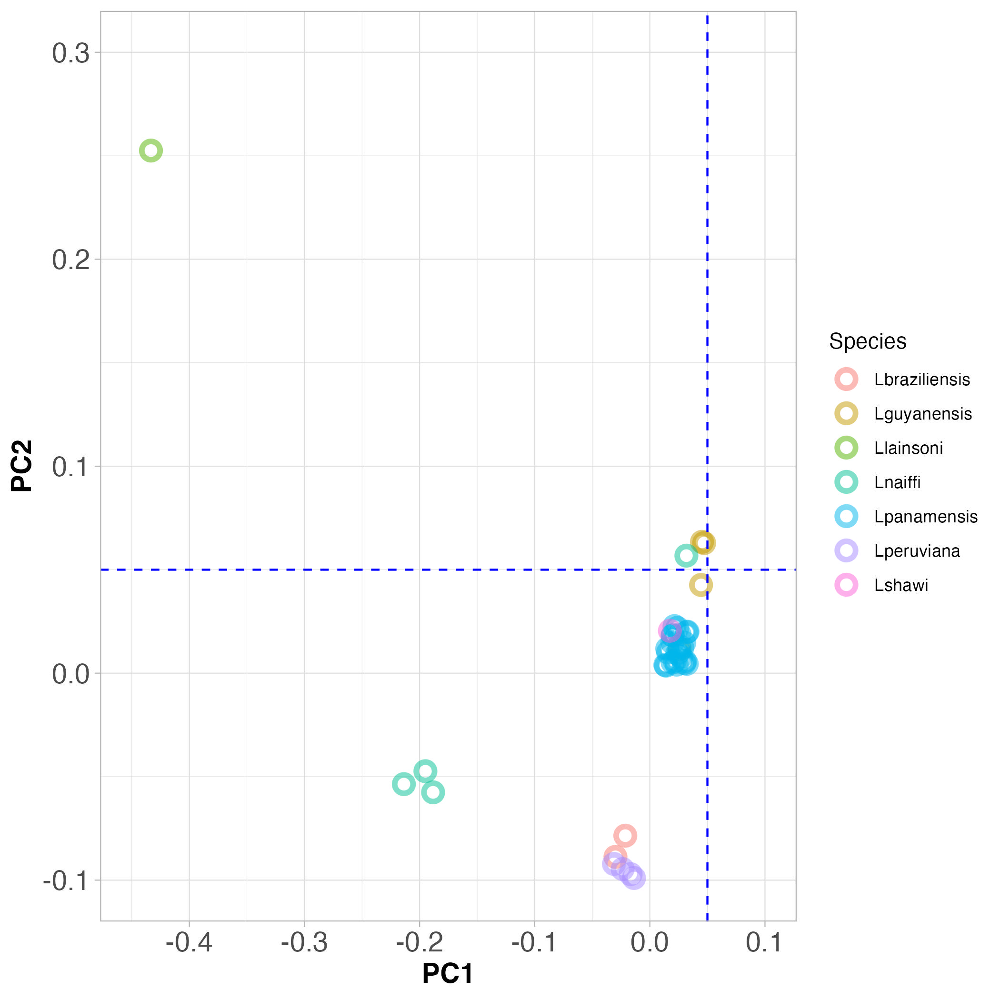
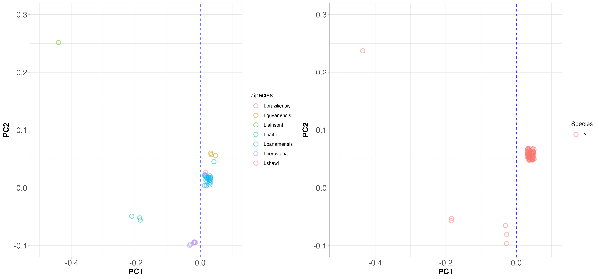
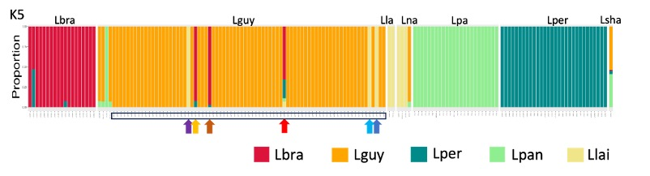
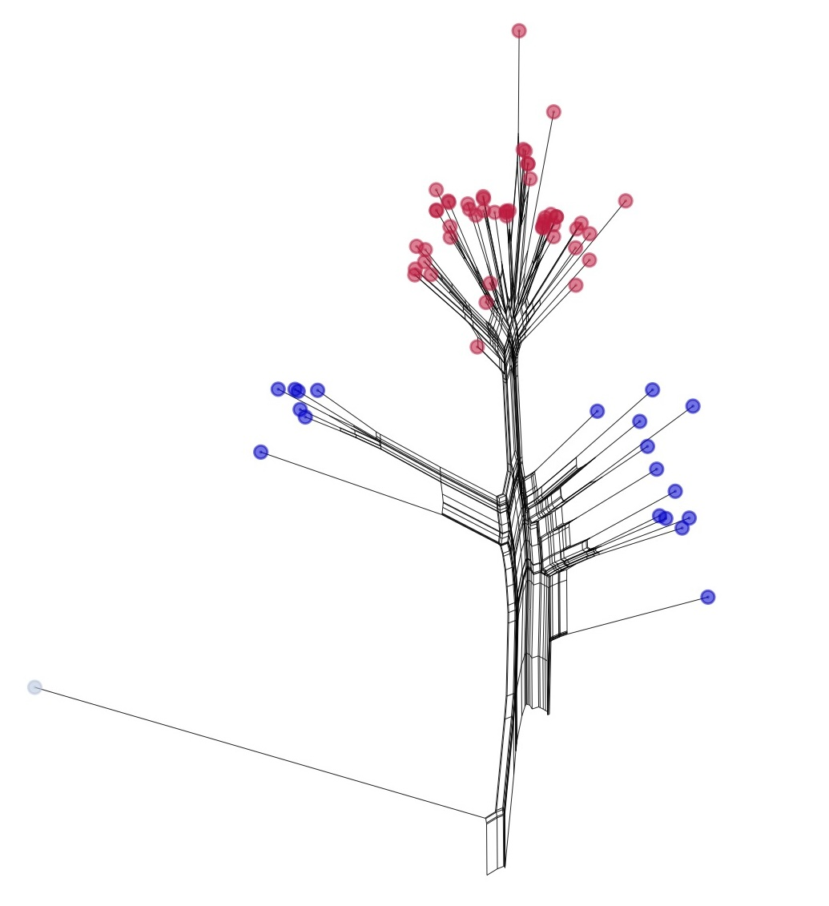
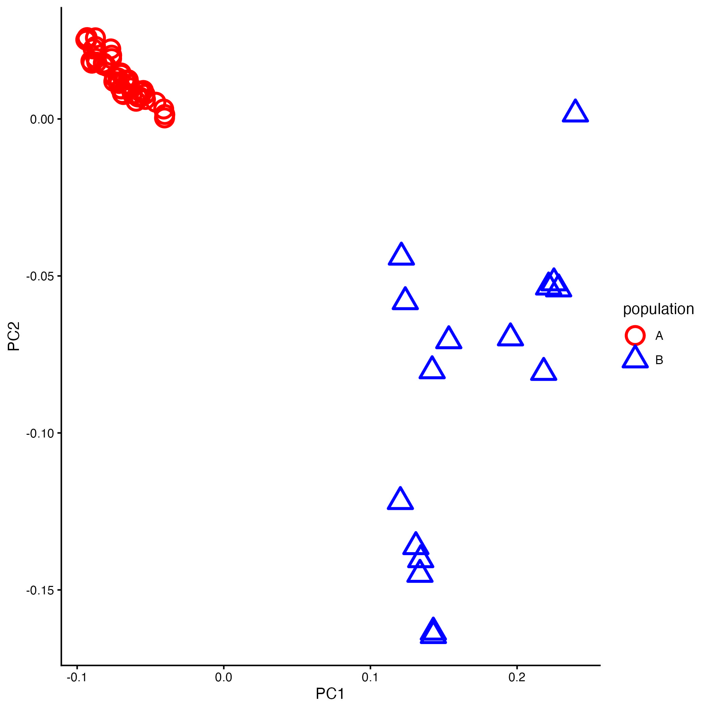
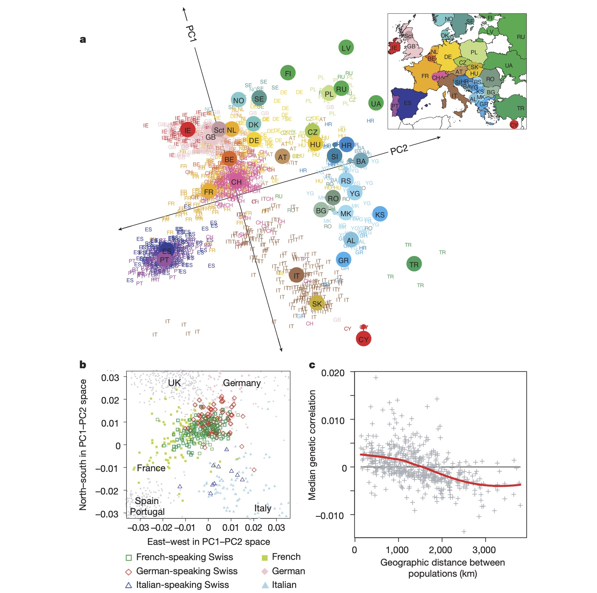

::: callout-important
# This document now contains answers to questions.
:::

# Learning objectives

The aims of this workshop are to:

- Consider how stochastic evolutionary processes like **random genetic drift** and **gene flow** affect populations and species
- Learn how to analyze and interpret population genomics data
- View a real-world example of population structure analysis

# Key Concepts examined in this Workshop

Before examining the dataset, keep in mind four primary concepts in population genomics:

- **Stochastic Evolutionary Processes:** Random **genetic drift** and **mutation** causes allele frequencies to fluctuate within and between populations, leading to populations differentiation over time
  - Genetic drift is the main process that leads to **population structure:** 
- **Gene Flow:** (e.g., via hybridization) can reduce differentiation between populations or species
- There are many ways to describe **population structure:** 
  - structure/admixture plots
  - principal components analysis (PCA)
  - phylogenetic trees and networks
- **Phylogenetic Analysis:** Phylogenetic trees and phylogenetic networks reconstruct evolutionary relationships can show us **gene flow** between populations or species
- **Real-World Applications of population genetics/genomics:** population genomics is useful. Here we show how population genomics enables us to study infectious disease dynamics

# Introduction

## Evolution, populations and genome data

You will be aware now from earlier on in this module that: 

- Most species contain multiple populations
- Genetically, a population is a group of individuals more closely related to each other than to other groups, reflecting shared ancestry
- Sometimes hybrids occur between these closely related species

In practice, when studying microorganisms, it can be hard to tell which population (even which species) an individual belongs to. This can be the case with multicellular species too. In this workshop, we will show how population genomics can help us to identify populations and species.

{#fig-arch}

## The topic for today

This workshop explores the population genomics of *Leishmania*, a diploid, sexually reproducing protozoan parasite. We focus on the Viannia species complex in South America—closely related species (including *L. guyanensis*) that can interbreed where their ranges overlap.

Our analysis focuses strictly on parasite genetic relationships. We will analyze single-nucleotide polymorphisms (SNPs) from parasites collected in Manaus, Brazil, combined with public data from the [European Nucleotide Archive](https://www.ebi.ac.uk/ena/browser/) to study species structure and hybridization.

# Exercises

## The phylogeny

A phylogenetic tree is a good first look at how similar or different many samples are. But when individuals mix between populations or species (hybridisation), a simple branching tree can be misleading.

Think of a tree of people grouped by ancestry. Where would you place someone with one parent from Spain and one from Fiji? They don’t fit neatly on a single branch with the Spanish and the Fijians. The same display issue can happen in nature when populations interbreed.

To handle this, we used a network approach (a splits network made with the software *SplitsTree* that can show conflicting signals in the data—like those caused by mixing between populations or species.

Below is our SplitsTree network. There are many samples, so coloured dots cluster tightly. The Manaus samples are dark blue. Most cluster near *Leishmania guyanensis* at the top. We marked the Manaus samples that do not with arrows.

### Interpreting the phylogeny
Now spend some time discussing the SplitsTree phylogeny, using the discussion points below as a guide.

::: callout-tip

# Discussion points: phylogeny

- What do the **lengths** of the branches in the tree represent?
- **Answer:**  Genetic distance between samples. Longer branches indicate more genetic differences.

- Look at the large tree in the center. Each species is represented by a different coloured dot. Do the species look clearly separated?
- **Answer:** Yes, the species are mostly separate.

- Now look at the inset on the right (in the red box), which shows the detail in the network. Here each individual samples is represented by a different coloured dot. Can you see populations in this network? Can you see an individual that is a hybrid between species?

- **Answer:** Yes. One individual is sits between *L. braziliensis* and *L. peruviana*, and is likely a hybrid between these two species.

- Is there any evidence that there might be gene flow between *Leishmania* species in this data?
- **Answer:** Yes, we see hybrids between species in the network, which indicates gene flow across species boundaries.

- What is the main evolutionary process that has caused the differentiation between species in this network?
- **Answer:** Genetic drift, a stochastic evolutionary process that causes populations to diverge genetically over time.

:::

----



## Principal components clustering

Population structure reflects how genetic diversity is organized, offering key insights into speciation and natural selection.

Principal Components Analysis (PCA) simplifies thousands of SNPs into a 2D plot where spatial distance represents genetic distance: samples close together are genetically similar, while distant points are genetically distinct. Individuals from the same species or population typically cluster together.

Look at Figure 3, and discuss the PCA plot with the people at your table, using the discussion points below as a guide.

- Do the species cluster genetically?
- Do *L. peruviana* and  *L. braziliensis* really look like two different species?

Note: The blue dashed lines are a guide to the eye to help you see the clusters.

Now look at Figure 4, which shows PCA clustering of Viannia species from throughout South America (on the left), and those that were collected from Manaus (on the right). Note that the PC axes are on the same scale here.

### Interpreting principal component plots

Use the discussion points below to discuss the PCA plots with the people at your table.

::: callout-tip

# Discussion points: PCA (species)

- Does it look like the samples that came from Manaus are all the same species?
- **Answer:**  No certainly not. Some are in the same position as *L. guyanensis*, but others are from different species.

- Since the positions on the PCA plot separate the species, does this help to identify the species from Manaus?
- **Answer:** Yes, some are *L. guyanensis*, some are *L. naiffi* and others *L. peruviana*.

- What processes contribute to the differences between two *Leishmania guyanensis* populations?
- **Answer:** Mutation and genetic drift.

- What process might reduce the differences between two *Leishmania guyanensis* populations?
- **Answer:** Gene flow.

- What does this tell you about the causes of cutaneous leishmaniasis in the Amazon region?
- **Answer:** Since all these samples were **collected** from cutaneous leishmaniasis patients, this disease is caused by at least three different *Leishmania species*.

- Since *Leishmania* are single-celled organisms and they all cause a similar disease, population genomics is the only way to identify which sample belongs to which species. Why would we not merely use PCR to identify the species?

- **Answer:** Because we do see hybrids. If we used PCR, we might misidentify hybrids as one species or the other, depending on which gene we amplified. Population genomics allows us to see the whole genome, so we can identify hybrids.

:::



## Admixture/STRUCTURE plots

A common way of showing population genomic data is with so-called STRUCTURE plots, generated using software called STRUCTURE, or a similar approach called ADMIXTURE, which is what we used. We’ll call these STRUCTURE plots for now.

STRUCTURE plots show the proportion of ancestry from different populations (or species) for each individual in the data set. Usually, each column of a STRUCTURE plot represents one individual, and the different colours within each column represent the proportion of ancestry from different populations (or species). 

STRUCTURE plots are usually used to describe population structure within a species, but they can also be used to describe structure between closely related species, as we do here.

Our STRUCTURE plot is below. Samples from Manaus are marked in the open rectangle at the bottom of the plot. Again, most look like *L. guyanensis*, and those that do not are marked with arrows, as we did in the phylogeny.

Figure 7. A STRUCTURE plot showing the *Leishmania* species we studied. Samples that were obtained from Manaus are marked in the open rectangle at the bottom of the plot. Most appear to be *Leishmania guyanensis*, but a few do not, and these are marked with arrows as we did in Figure 2, the SplitsTree phylogeny.

::: callout-tip

# Discussion points: The STRUCTURE plot

The STRUCTURE algorithm uses genotype data to estimate individual ancestry proportions across $K$ genetic clusters. It allows us to directly observe population structure, test for gene flow (interbreeding), and infer how processes like genetic drift and migration shape diversity.

The most obvious thing about this plot is that the species are different colours. Each column is a different strain, and the colours represent the proportion of this strain’s ancestry that is derived from each species. If there are hybrids between species, we would expect to see columns with multiple colours.

- Does this visualisation of the data suggest that there is **extensive** breeding between species in the Viannia group? If so, this might result in **gene flow** between species. If not, this would suggest that the species are mostly reproductively isolated from each other.

- **Answer:** Yes, we can see some hybrids, consistent with interbreeding between species.

- Consider the *Leishmania* parasites circulating around Manaus (see Figure 4). Do they all look like one species, or are there multiple species present?
- **Answer:** No, there are multiple species present, consistent with what we saw in the phylogeny and PCA plots.

:::

## Populations of Leishmania guyanensis

In each species, there are probably multiple populations. In the case of *Leishmania guyanensis*, found two populations. We show the evidence for this in two ways. In Figure 6, we show a SplitsTree network phylogeny, and in Figure 7 we show a PCA plot.

::: {layout-ncol=2 layout-valign="center"}

:::

::: callout-tip

# Discussion points:  *L. guyenensis* populations

Examine the phylogeny in Figure 6A. Can you see the long branch that separates the red and blue samples? 

- What does the length of the branch tell us about the genetic distance between the red and blue samples?
- **Answer:** The length of the branch indicates the genetic distance.

Examine the PCA plot in Figure 6B.

- What do you notice about the positions of the red and blue points? Is is consistent with the phylogeny?
- **Answer:** Yes, the red and blue points are separated in the PCA plot, consistent with the phylogeny.

- What process or processes might have caused the differentiation between the two populations of *L. guyanensis*?
- **Answer:** Genetic drift.

- The ancestral (older) blue population is found in the Amazon rainforest. The newer (younger) red population is found in disturbed habitats, such as farmed  areas. Since the red population is found in a new habitat, what other process might be occurring in this population?

- **Answer:** Natural selection might be occurring in the red population, as it adapts to the new habitat.

:::

DJ UP TO HERE

# Summary: what we have learned

- Population genomics data can be used to explore population structure and hybridisation between populations and species.

- There are different ways of visualising population genomics data, each with their own strengths and weaknesses.

- In this workshop, we have seen examples of:

  - isolation by distance (populations/species distributed across countries)
  - multiple species in one location (Manaus), with rare hybrids between species

# After the workshop: exam-style questions

## Question 1. Populations and migration

A PCA plot of human populations from Europe is shown in Figure 8 below. Each point is an individual, and they are coloured by the country they come from. Small coloured labels represent individuals, and large coloured points represent median PC1 and PC2 values for each country.

- a) Is there evidence for extensive migration of individuals between countries in Europe? Explain your answer.

- b) What can we infer from these data about the alleles within countries that are close together on the PCA plot (e.g., Spain and Portugal) compared to countries that are far apart on the PCA plot (e.g., Finland and Italy)?

- c) What can we infer from these data about interbreeding between countries? Do between-country marriages look common, or the exception?

- d) Panel b of the plot shows the PCA coordinates of people from Switzerland, with individuals coloured by the language they speak (Germanic, French or Italian). Note that the location of these groups on the PCA plot corresponds to the location of their home countries on the PCA plot in panel a. Explain how this kind of analysis could be used to understand: (i) the migration of a parasite; (ii) how to conserve a threatened species. 

- e) Panel c of the plot shows the correlation between genetic distance and geographic distance (km between individuals’ birthplaces). What phenomenon does this illustrate? How would you expect this to differ for a highly mobile species, such as birds, versus a less mobile species, such as fish in lakes?

### Model answers

a) Is there evidence for extensive migration of individuals between countries in Europe? Explain your answer.

**Answer:** If there were extensive migration between countries, we would expect to see individuals from different countries mixed together on the PCA plot. However, the PCA plot shows that individuals from the same country *generally* cluster together, to the exclusion of other countries. There are exceptions, however, such as Spain and Portugal that appear to be mixing. 

b) What can we infer from these data about the alleles within countries that are close together on the PCA plot (e.g., Spain and Portugal) compared to countries that are far apart on the PCA plot (e.g., Finland and Italy)?

**Answer:** We expect from the PCA plot that there are some alleles within countries that are shared between countries that are close together on the PCA plot (e.g., Spain and Portugal). In contrast, countries that are far apart on the PCA plot (e.g., Finland and Italy) are expected to share fewer alleles.

c) What can we infer from these data about interbreeding between countries? Do between-country marriages look common, or the exception?

**Answer:**  Between-country marriages appear to be the exception rather than the rule.

d) Panel b of the plot shows the PCA coordinates of people from Switzerland, with individuals coloured by the language they speak (Germanic, French or Italian). Note that the location of these groups on the PCA plot corresponds to the location of their home countries on the PCA plot in panel a. Explain how this kind of analysis could be used to understand: (i) the migration of a parasite; (ii) how to conserve a threatened species. 

  - (i) The migration of a parasite: the Switzerland PCA shows three barely-separated groups, indicating frequent mixing. If we saw such a signal for a parasite, it would suggest that the parasite is moving frequently between regions.

  - (ii) To conserve a threatened species so that it is robust to threats such as diseases and environmental change, we would like to retain the genetic diversity of the species. If we saw a PCA plot with distinct clusters, this would suggest that there are distinct populations that should be conserved separately to retain genetic diversity, and we should aim to preserve all these populations.

e) Panel c of the plot shows the correlation between genetic distance and geographic distance (km between individuals’ birthplaces). What phenomenon does this illustrate? How would you expect this to differ for a highly mobile species, such as birds, versus a less mobile species, such as fish in lakes?

**Answer:** 

This illustrates the phenomenon of *isolation by distance*, where individuals that are geographically close are also genetically similar. Isolation by distance occurs because individuals are more likely to breed with nearby individuals than with distant individuals, and drift, new mutations and selection cause populations to diverge genetically between locations.

For a large highly mobile species, such as birds, we would expect less isolation by distance, because individuals can move long distances and interbreed with individuals from far away. In contrast, for a less mobile species, such as fish in lakes, or a species that is smaller we would expect stronger isolation by distance, because individuals are more likely to breed with nearby individuals.

Figure 8. A PCA plot of human populations from Europe. Each point is an individual, and they are coloured by the country they come from. Small coloured labels represent individuals, and large coloured points represent median PC1 and PC2 values for each country. 

## Question 2. Understanding populations from DNA

- a) Outline how population genomic data are collected; starting with the collection of samples from individuals, laboratory work, and the data analysis steps to obtain a VCF file containing SNP data.

- b) Name and briefly explain three methods to display population genomic data to show genetic relatedness (population structure) between individuals. For each method, give one strength and one weakness.

- c) List three features of the genetics of natural populations that we can learn from population genomic data.

### Model answers

a) Outline how population genomic data are collected—starting with the collection of samples from individuals, laboratory work, and the data analysis steps to obtain a VCF file containing SNP data.

**Answer:** 

Blood, tissue or whole organism samples are collected from individuals in the region and species of interest. Ideally, we would obtain tens to hundreds of samples. We then extract DNA from these samples in the laboratory. DNA is sequenced using a high-throughput sequencing platform, such as Illumina. Reads are then mapped to a reference genome, and variants (SNPs) are called using variant-calling software. The output is a VCF file containing SNP data for all individuals.

b) Name and briefly explain three methods to display population genomic data to show genetic relatedness (population structure) between individuals. For each method, give one strength and one weakness.

**Answer:** 

Method 1: phylogenetic tree. Strength: Shows populations and relatedness clearly. Weakness: Performs badly with hybrids, or other complex situations.

Method 2: principle components analysis (PCA). Strengths: Shows hybrids well. Can sometimes show population geography patterns. Weakness: Does not show direction of evolution as phylogenetic trees do, nor quantitative information about timing of events that we can obtain from phylogenetic tree branch lengths.

Method 3: STRUCTURE plot. Strength: Shows hybrids well, and can distinguish species that do not appear to hybridism. Weakness: Does not show the genetic distances or relatedness between individuals or populations very well.

c) List three features of the genetics of natural populations that we can learn more about from population genomic data.

**Answer:** 

- Population structure: by identifying genetically similar individuals, we can define populations within a species.
- Migration: by identifying genetically similar individuals in different locations, we can infer migration between populations.
- Hybridisation: by identifying individuals with mixed ancestry from different populations or species, we can determine if hybridisation is occurring, or the populations are isolated.
- Selection: by looking for genomic signatures of selection, we can identify genes or genomic regions that are under selection in natural populations.